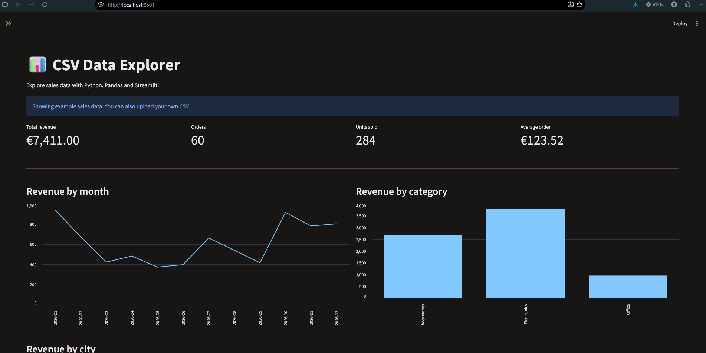
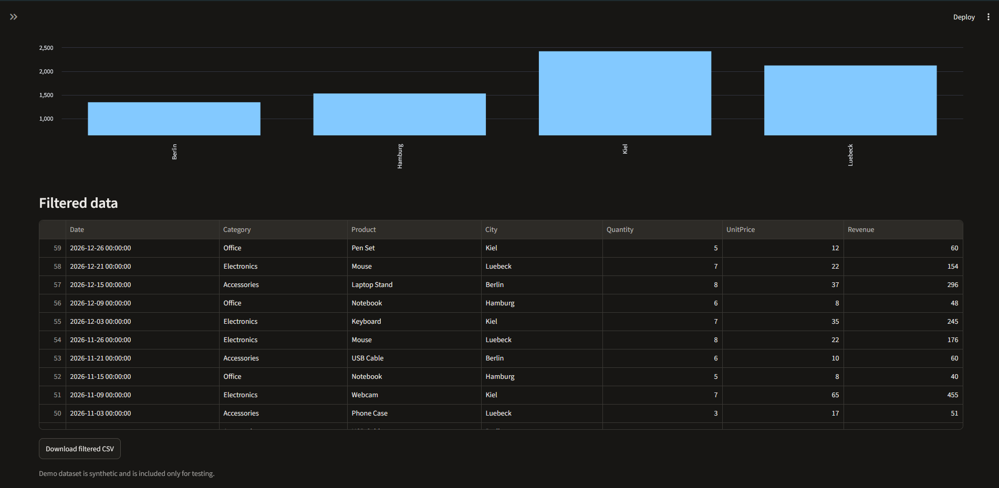

# CSV Data Explorer

A simple Streamlit dashboard to analyze sales data using Python and Pandas.

## Features

- Upload a CSV or use the included example data
- Filter results by city and category
- See revenue, orders, units sold and average order value
- View monthly, category and city charts
- Download the filtered data as a CSV file

## Tech stack

Python, Streamlit, Pandas

## How to run

```bash
python -m venv .venv
```

Activate the environment on **Windows PowerShell**:

```powershell
.\.venv\Scripts\Activate.ps1
```

On macOS or Linux, use `source .venv/bin/activate` instead.

Then install and start:

```bash
pip install -r requirements.txt
streamlit run app.py
```

## CSV format

Your CSV needs these columns:

`Date, Category, Product, City, Quantity, UnitPrice`

Example:

```csv
Date,Category,Product,City,Quantity,UnitPrice
2026-01-05,Electronics,Keyboard,Kiel,2,35.00
```

`Date` must be readable as a date, and `Quantity` / `UnitPrice` must be numbers. The app calculates `Revenue` automatically. Rows with invalid or missing values are skipped.

The included file `data/sample_sales.csv` contains **synthetic example data**, not real customer data.

## Project structure

```text
Streamlit-Data-Explorer/
├── app.py
├── data/
│   └── sample_sales.csv
├── requirements.txt
├── .gitignore
└── README.md
```

## Author

Developed by Saman Farshad

## Screenshots

### Sales Dashboard


### Sales Data Table
